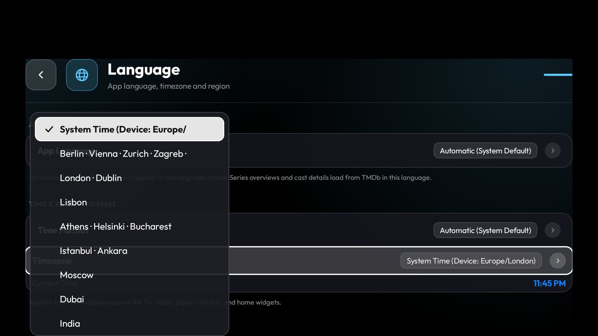
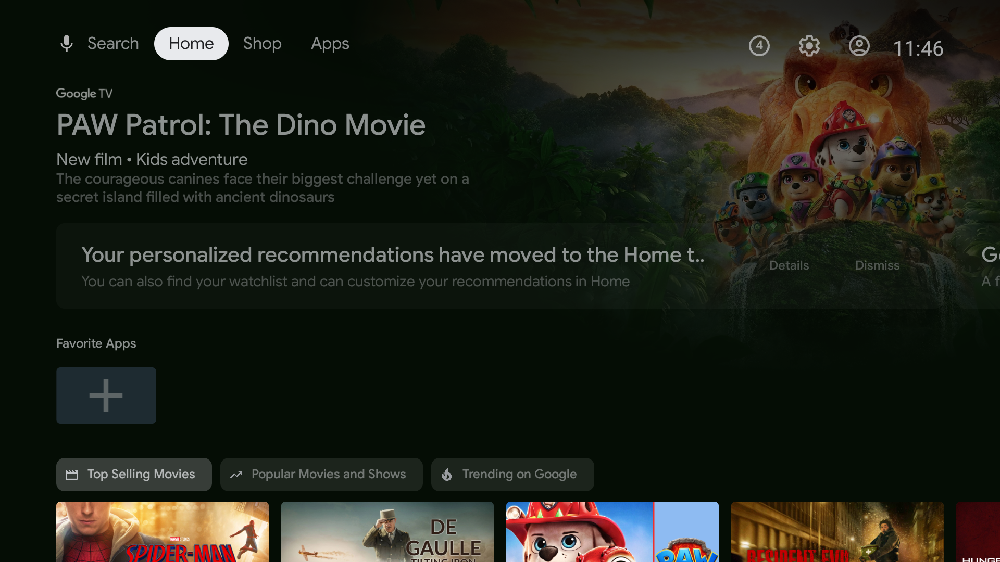
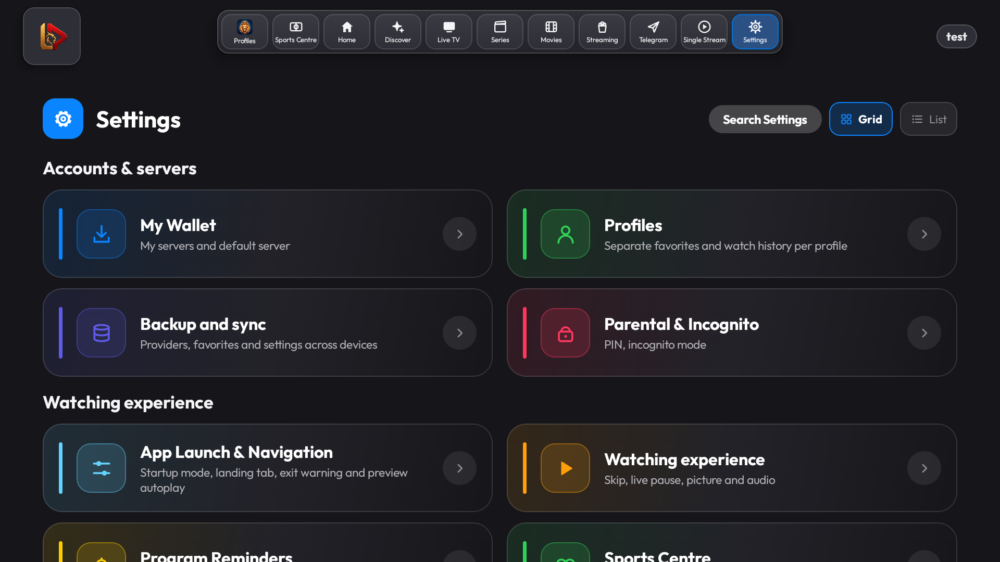

# 👑 LionPlay TV

<div align="center">


### Next-Generation Media Player for Android TV & Amazon Fire TV

[-34C759?style=for-the-badge&logo=android)](https://github.com/lionplayiptvapp-bit/lionplay-tv/releases/download/v1.0.0/LionPlay-AndroidTV-FireTV.apk)
[](https://go.aftvnews.com/2007080)
[](LICENSE)

<br/>

**Choose Language / Dil Seçimi:**  
[🇬🇧 **English (Official Documentation)**](#-english) &nbsp;•&nbsp; [🇹🇷 **Türkçe (Resmi Dokümantasyon)**](#-türkçe) &nbsp;•&nbsp; [🇹🇷 Türkçe Ayrı Sayfa (README.tr.md)](README.tr.md)

</div>

---

# 🇬🇧 English

A high-performance, modern dark-glass IPTV media player designed specifically for **Amazon Fire TV, Google TV, and Android TV**, built with Kotlin, Jetpack Compose, and hardware-accelerated Media3 / FFmpeg decoding. Fully optimized for television remote controls (D-Pad).

<div align="center">
  
</div>

> **⚖️ Legal Disclaimer:** LionPlay does not host, provide, sell, or distribute any media content, television streams, channels, or playlists. It is an independent media player application developed for playing personal, legally authorized IPTV sources (Xtream Codes API, M3U / M3U8 playlists, Stalker portals) on television screens.

---

## 📺 Platform & Version Compatibility

> **💡 Single Universal APK Architecture:**  
> There is no need to maintain separate installation packages for Android TV and Amazon Fire TV. LionPlay integrates the system libraries, D-Pad navigation engines, and store APIs for both platforms inside a single universal APK. One binary runs with optimal hardware acceleration across all supported television devices.

| Platform | Supported OS Versions | Popular Compatible Devices | Status |
| :--- | :--- | :--- | :--- |
| **Amazon Fire TV** | **Fire OS 6, 7, 8**<br>(Android 7.1 Nougat up to Android 11+) | Fire TV Stick (Lite, 4K, 4K Max), Fire TV Cube, Fire TV Edition Smart TVs | Fully Compatible (100% Support) |
| **Google TV** | **Android 10, 11, 12, 13, 14+** | Chromecast with Google TV (HD & 4K), Sony Bravia Google TV, TCL, Philips, Grundig | Fully Compatible (100% Support) |
| **Android TV** | **Android 6.0 Marshmallow (API 23) up to 14+** | Xiaomi Mi Box S, Mi TV Stick 4K, Nvidia Shield TV / Pro, Next, Nokia Streaming Box | Fully Compatible (100% Support) |

---

## 🚀 Quick Installation Guide

### Method 1: Via the Downloader App (Recommended & Fastest)

From your TV's application store (Amazon Appstore or Google Play Store), launch the free **Downloader by AFTVnews** app:

1. In the Downloader URL box, enter the code **`2007080`** and click **Go**.  
   *(Alternative short URL: `is.gd/lionplayapk`)*
2. The download will begin immediately from the official GitHub release servers.
3. Once the download completes, select **Install** to finish the setup.

### Method 2: Direct Download Links

* **Direct Universal APK (GitHub Releases):**  
  [https://github.com/lionplayiptvapp-bit/lionplay-tv/releases/download/v1.0.0/LionPlay-AndroidTV-FireTV.apk](https://github.com/lionplayiptvapp-bit/lionplay-tv/releases/download/v1.0.0/LionPlay-AndroidTV-FireTV.apk)
* **Short Download Link:** [https://is.gd/lionplayapk](https://is.gd/lionplayapk)
* **Web Distribution & Management Portal:** [https://androidtvfireos.lionplay.workers.dev](https://androidtvfireos.lionplay.workers.dev)

### Method 3: Sideloading via ADB or USB Storage

```bash
adb install -r LionPlay-AndroidTV-FireTV.apk
```

---

## ✨ Core Features

* **⚡ 4-Screen Multi-View:** Watch up to 4 simultaneous live sports broadcasts or channels on a single screen without stutter or audio interference.
* **🤖 Real-Time AI Live Subtitles:** Instant on-the-fly subtitle generation and multi-language translation for international television channels and movies.
* **📺 Comprehensive Playlist Protocols:** Full support for Xtream Codes API, M3U / M3U8 URLs, local playlist files, and Stalker portals. Seamlessly merge multiple accounts into one unified interface.
* **🎬 Hardware-Accelerated Playback:** Media3 (ExoPlayer) pipeline with FFmpeg audio decoding for AC3, E-AC3, and DTS streams, full 4K HDR playback, and Auto Frame Rate (AFR / Auto-FPS) matching.
* **⏪ EPG & Catch-up Archive:** Electronic program guide with backward time-shifting, program reminders, and full stream archival browsing.
* **🎨 Apple tvOS Dark Glass Interface:** Fluid animations, modern dark-glass aesthetics, 12 vibrant color accents, and comfortable remote control focus management.
* **🍿 Personal Media Servers:** Connect directly to home Jellyfin, Plex, Emby, and local network SMB / NAS media storage libraries.

---

## 📱 Multi-Device Management & Dynamic QR Portal (1 License = 5 TVs)

LionPlay provides multi-screen convenience by supporting up to **5 different television devices** under a single license:

* **Remote-Free Activation:** Scan the dynamic QR code displayed on your TV screen using your smartphone camera to activate your license instantly without typing credentials with a remote control.
* **Device Management & Removal:** Access the secure mobile management portal to view all connected television models and delete old or inactive devices with a single tap to free up slots for new screens.
* **Cryptographic Security:** Each device management link is secured with a unique cryptographic session token. Never share your management link with unauthorized third parties.

---

## 🔄 In-App Over-The-Air (OTA) Updates

Keeping LionPlay up to date is completely frictionless without requiring reinstallation or manual APK downloads:

* **Automated Background Checking:** Configure automated update checks in **Settings ➔ About**. When enabled, the app quietly checks for newer versions on startup.
* **Manual One-Click Check:** Click **Check for updates now** to immediately query the latest release and install updates directly from the TV.
* **Zero Data Loss Guarantee:** All your playlists, favorites, watch history, settings, and license information are strictly preserved throughout updates.

---

## 📸 Screenshots Showcase

| 🏠 Home Screen Experience | ⚡ Multi-View & EPG Guide | ⚙️ Media Center & Settings |
| :---: | :---: | :---: |
| <br/><sub>Dark glass navigation & content showcases</sub> | <br/><sub>4 simultaneous streams & electronic guide</sub> | <br/><sub>Account management & QR portal</sub> |

---

## ❓ Frequently Asked Questions (FAQ)

<details>
<summary><b>1. Do I need separate APKs for Fire TV and Google TV?</b></summary>
<br/>
No. LionPlay is engineered with a Universal APK architecture. A single APK file runs natively on all Android TV, Google TV, and Amazon Fire TV hardware.
</details>

<details>
<summary><b>2. Will an update overwrite my playlists, favorites, or settings?</b></summary>
<br/>
No. LionPlay updates apply cleanly over the existing installation, fully preserving your local database, active license, playlists, and user preferences.
</details>

<details>
<summary><b>3. How many television screens can I use with one license?</b></summary>
<br/>
A standard LionPlay license covers up to 5 television devices simultaneously. When you reach the limit, simply scan the TV QR code on your smartphone to remove older devices and register new ones.
</details>

<details>
<summary><b>4. Are TMDB or OMDb API keys mandatory?</b></summary>
<br/>
No. By default, metadata provided by your playlist server is used. However, entering free TMDB or OMDb keys will automatically enrich movie and series entries with high-resolution posters, synopses, cast information, and IMDb ratings.
</details>

<details>
<summary><b>5. How can I resolve black screen issues while audio continues playing?</b></summary>
<br/>
Open Settings and toggle Hardware Acceleration or switch the decoding profile to Tunneled / Auto-FPS to select the optimal video rendering mode for your television's display chipset.
</details>

---

## 🛠️ Building from Source

**Requirements:** Android Studio (Ladybug or later), JDK 17, Android SDK.

```bash
git clone https://github.com/lionplayiptvapp-bit/android.git
cd android
./gradlew assembleRelease
```

The output APK will be generated at `app/build/outputs/apk/release/app-release.apk`.

---

## 📄 License & Copyright

Copyright (C) 2026 LionPlay TV Contributors.  
LionPlay is free and open-source software distributed under the terms of the **GNU General Public License v3.0 (GPL-3.0)**. It incorporates the FFmpeg native audio decoding suite. For full legal text and third-party notices, please refer to the [LICENSE](LICENSE) file.

<br/>

---

<div align="center">
  <a href="#-lionplay-tv">⬆ Back to Top (English)</a> &nbsp;&nbsp;•&nbsp;&nbsp; <a href="#-türkçe">Türkçe Bölümüne Geç ⬇</a>
</div>

---

# 🇹🇷 Türkçe

**Amazon Fire TV, Google TV ve Android TV** cihazları için özel olarak tasarlanmış, Kotlin, Jetpack Compose ve donanım hızlandırmalı Media3 / FFmpeg mimarisiyle geliştirilmiş modern, koyu cam (dark glass) IPTV medya oynatıcısı. Televizyon kumandaları (D-Pad) ile %100 uyumlu ve akıcı gezinme deneyimi sunar.

<div align="center">
  
</div>

> **⚖️ Yasal Uyarı:** LionPlay herhangi bir medya içeriği, televizyon kanalı, yayın akışı veya oynatma listesi barındırmaz, satmaz ve dağıtmaz. Kullanıcıların yasal olarak erişim hakkına sahip olduğu kişisel IPTV kaynaklarını (Xtream Codes API, M3U / M3U8 çalma listeleri, Stalker portalları) televizyon ekranında oynatmak için geliştirilmiş bağımsız bir medya oynatıcı yazılımıdır.

---

## 📺 Platform ve Sürüm Uyumluluğu

> **💡 Tek Evrensel APK (Universal APK) Avantajı:**  
> Android TV ve Amazon Fire TV için uygulamayı iki ayrı kurulum paketine ayırmaya gerek yoktur. LionPlay, her iki ekosistemin sistem kütüphanelerini, televizyon kumandası (D-Pad) odak yönetimini ve mağaza servislerini tek bir evrensel APK dosyasında birleştirir. Aynı dosya tüm uyumlu televizyonlarda en yüksek performansla çalışır.

| Platform | Desteklenen Sürümler | Uyumlu Popüler Cihazlar | Durum |
| :--- | :--- | :--- | :--- |
| **Amazon Fire TV** | **Fire OS 6, 7, 8**<br>(Android 7.1 Nougat ila Android 11+) | Fire TV Stick (Lite, 4K, 4K Max), Fire TV Cube, Fire TV Edition Akıllı Televizyonlar | Tam Uyumlu (%100 Destek) |
| **Google TV** | **Android 10, 11, 12, 13, 14+** | Chromecast with Google TV (HD & 4K), Sony Bravia Google TV, TCL, Philips, Grundig | Tam Uyumlu (%100 Destek) |
| **Android TV** | **Android 6.0 Marshmallow (API 23) ila 14+** | Xiaomi Mi Box S, Mi TV Stick 4K, Nvidia Shield TV / Pro, Next, Nokia Streaming Box, Sunny | Tam Uyumlu (%100 Destek) |

---

## 🚀 Hızlı Kurulum Rehberi

### Yöntem 1: Downloader Uygulaması ile Kurulum (En Kolay ve Hızlı Yol)

Televizyonunuzun uygulama mağazasından (Amazon Appstore veya Google Play Store) ücretsiz **Downloader by AFTVnews** uygulamasını açın:

1. Downloader arama çubuğuna **`2007080`** kodunu girin ve **Go** butonuna basın.  
   *(Alternatif kısa bağlantı: `is.gd/lionplayapk`)*
2. İndirme işlemi doğrudan resmi GitHub sunucularından başlayacaktır.
3. İndirme tamamlandığında ekrana gelen **Yükle (Install)** butonuna basarak kurulumu bitirin.

### Yöntem 2: Doğrudan İndirme Bağlantıları

* **Doğrudan Evrensel APK (GitHub Releases):**  
  [https://github.com/lionplayiptvapp-bit/lionplay-tv/releases/download/v1.0.0/LionPlay-AndroidTV-FireTV.apk](https://github.com/lionplayiptvapp-bit/lionplay-tv/releases/download/v1.0.0/LionPlay-AndroidTV-FireTV.apk)
* **Kısa İndirme Bağlantısı:** [https://is.gd/lionplayapk](https://is.gd/lionplayapk)
* **Web Dağıtım ve Yönetim Portalı:** [https://androidtvfireos.lionplay.workers.dev](https://androidtvfireos.lionplay.workers.dev)

### Yöntem 3: ADB veya USB Bellek ile Sideload

```bash
adb install -r LionPlay-AndroidTV-FireTV.apk
```

---

## ✨ Öne Çıkan Temel Özellikler

* **⚡ 4'lü Çoklu Ekran (Multi-View):** Aynı anda 4 farklı canlı spor veya haber yayınını tek ekranda donma veya ses çakışması olmadan eşzamanlı izleyin.
* **🤖 Gerçek Zamanlı AI Altyazı:** Yabancı canlı televizyon yayınlarında ve filmlerde anlık Türkçe altyazı ve ses çevirisi üretimi.
* **📺 Modern Oynatma Listesi Desteği:** Xtream Codes API, M3U / M3U8 bağlantıları veya dosyaları ile Stalker portal desteği. Birden fazla listeyi tek ekranda birleştirme imkanı.
* **🎬 Donanım Hızlandırmalı Oynatıcı:** Media3 (ExoPlayer) + FFmpeg tabanlı AC3, E-AC3 ve DTS ses çözücü, 4K HDR desteği ve otomatik kare hızı eşleme (AFR / Auto-FPS).
* **⏪ EPG ve Geriye Dönük Yayın (Catch-up):** Elektronik program rehberi (EPG), geriye dönük yayın arşivi ve program zamanlayıcıları.
* **🎨 Apple tvOS Koyu Cam Tasarım:** Akıcı animasyonlar, koyu cam (dark glass) estetiği ve televizyon kumandası ile sezgisel odak yönetimi.
* **🍿 Kişisel Medya Sunucuları:** Jellyfin, Plex, Emby ve yerel ağdaki SMB / NAS arşivlerinize doğrudan bağlantı.

---

## 📱 Çoklu Cihaz Yönetimi ve Dinamik QR Kod Portalı (1 Lisans = 5 Televizyon)

LionPlay tek bir lisans anahtarı ile **5 farklı televizyon cihazında** eşzamanlı kullanım imkanı sunar:

* **Kumandasız Hızlı Aktivasyon:** TV ekranında beliren dinamik QR kodu akıllı telefonunuzun kamerasıyla okutarak, televizyon kumandasıyla tek tek harf girmeden lisansınızı saniyeler içinde tanımlayabilirsiniz.
* **Cihazları Listeleme ve Çıkarma:** Telefondan açılan yönetim portalı üzerinden lisansınıza bağlı tüm televizyon modellerini görüntüleyebilir; eski veya kullanmadığınız cihazları tek dokunuşla silerek yeni televizyonlar için yer açabilirsiniz.
* **Güvenlik Güvencesi:** Cihaz yönetim bağlantısı cihazınıza özel kriptografik anahtarla oluşturulur. Yetkisiz cihaz silinmelerini önlemek adına bağlantı adresinizi üçüncü kişilerle paylaşmayınız.

---

## 🔄 Uygulama İçi Otomatik Güncelleme Sistemi (OTA)

Uygulamanızı güncellemek için yeniden kurulum yapmanıza, dosya indirmenize veya ayarlarınızı sıfırlamanıza gerek yoktur:

* **Otomatik Kontrol Seçeneği:** **Ayarlar ➔ Hakkında** menüsünden otomatik güncelleme denetimini açıp kapatabilirsiniz. Açık olduğunda uygulama her başlatıldığında yeni sürümleri arka planda sessizce kontrol eder.
* **Manuel Sürüm Sorgulama:** **Şimdi Güncelleme Ara** butonuna basarak yeni bir sürüm olup olmadığını hemen sorgulayabilir ve varsa tek tıkla doğrudan televizyon üzerinden indirip yükleyebilirsiniz.
* **Veri ve Liste Güvencesi:** Güncelleme işlemleri sırasında kayıtlı oynatma listeleriniz, favori kanallarınız, izleme geçmişiniz ve lisans bilgileriniz **eksiksiz olarak korunur**.

---

## 📸 Ekran Görüntüleri

| 🏠 Ana Sayfa Deneyimi | ⚡ Çoklu Ekran (Multi-View) ve EPG | ⚙️ Medya Merkezi ve Ayarlar |
| :---: | :---: | :---: |
| <br/><sub>Koyu cam gezinme ve içerik vitrini</sub> | <br/><sub>4 yayın eşzamanlı ve program rehberi</sub> | <br/><sub>Hesap yönetimi ve cihaz QR portalı</sub> |

---

## ❓ Sıkça Sorulan Sorular (SSS)

<details>
<summary><b>1. Fire TV için ayrı, Google TV için ayrı APK indirmem gerekir mi?</b></summary>
<br/>
Hayır. LionPlay evrensel (Universal) mimari ile derlenmiştir. Tek bir APK dosyası tüm Android TV, Google TV ve Amazon Fire TV modellerinde doğrudan ve sorunsuz çalışır.
</details>

<details>
<summary><b>2. Güncelleme yaptığımda kayıtlı kanallarım veya ayarlarım silinir mi?</b></summary>
<br/>
Kesinlikle hayır. LionPlay güncellemeleri mevcut veritabanını, lisansınızı ve kayıtlı oynatma listelerinizi koruyarak mevcut sistemin üzerine güvenle kurulur.
</details>

<details>
<summary><b>3. Bir lisans kodunu kaç farklı cihazda kullanabilirim?</b></summary>
<br/>
LionPlay lisansı ile 5 farklı televizyon cihazını eşzamanlı olarak aktif edebilirsiniz. Cihaz limitine ulaştığınızda televizyondaki QR kodu telefonunuzla okutarak eski cihazlarınızı tek tıkla silebilir ve yeni televizyonunuzu ekleyebilirsiniz.
</details>

<details>
<summary><b>4. Uygulama içi TMDB veya OMDb API anahtarları girmek zorunlu mudur?</b></summary>
<br/>
Zorunlu değildir. Sağlayıcınızın kendi afiş ve yayın bilgileri doğrudan kullanılır. Ancak isteğe bağlı olarak ücretsiz TMDB veya OMDb anahtarı eklerseniz film ve dizilerin Türkçe açıklamaları, IMDb puanları ve oyuncu kadrosu otomatik olarak zenginleştirilir.
</details>

<details>
<summary><b>5. Televizyonumda ses geliyor ancak siyah ekran varsa ne yapmalıyım?</b></summary>
<br/>
Ayarlar menüsünden donanım hızlandırma modunu kontrol edebilir veya oynatıcı motorunu Tunneled / Auto-FPS moduna alarak cihazınızın yonga setine en uygun görüntü çıkışını sağlayabilirsiniz.
</details>

---

## 🛠️ Kaynak Koddan Derleme

**Gereksinimler:** Android Studio (Ladybug veya üstü), JDK 17, Android SDK.

```bash
git clone https://github.com/lionplayiptvapp-bit/android.git
cd android
./gradlew assembleRelease
```

Derlenen APK dosyası `app/build/outputs/apk/release/app-release.apk` dizininde üretilir.

---

## 📄 Lisans ve Telif Hakkı

Copyright (C) 2026 LionPlay TV Katkıda Bulunanları.  
LionPlay, **GNU General Public License v3.0 (GPL-3.0)** kapsamında yayınlanan özgür ve açık kaynak kodlu bir yazılımdır. FFmpeg yerel ses çözücü kütüphanelerini içerir. Ayrıntılı bilgi için [LICENSE](LICENSE) dosyasına başvurabilirsiniz.

<br/>

<div align="center">
  <a href="#-lionplay-tv">⬆ Başa Dön (Türkçe)</a> &nbsp;&nbsp;•&nbsp;&nbsp; <a href="#-english">Switch to English (Top)</a>
</div>
