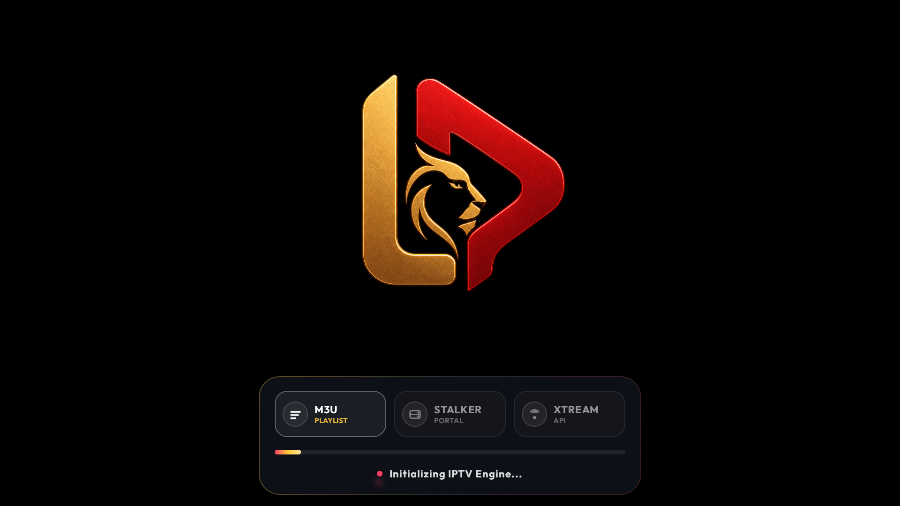
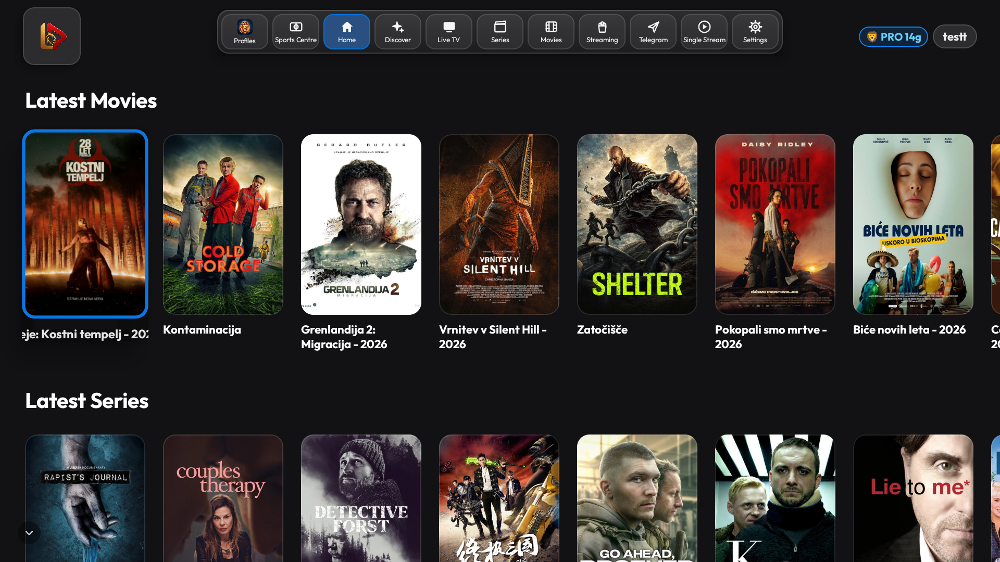

<div align="center">


# 👑 LIONPLAY TV
### Next-Generation Media Player for Android TV & Amazon Fire TV

[](https://github.com/lionplayiptvapp-bit/lionplay-tv/releases/latest)
[](https://github.com/lionplayiptvapp-bit/lionplay-tv/releases/latest)
[](https://go.aftvnews.com/)
[](https://t.me/+DCDbZEYDZ7tmZGM0)
[](https://androidtvfireos.lionplay.workers.dev)
[](https://androidtvfireos.lionplay.workers.dev)

<br/>

**Experience TV like never before with 4-Screen Multi-View, Real-Time AI Live Subtitles, 3-Column Freeview & Cinematic Ultra-Smooth Modern TV Interface.**

[📥 Download Latest APK](#-quick-download-links) • [📺 Installation Guide](#-easy-fire-tv--android-tv-installation) • [💎 Premium Features](#-premium-features) • [💳 Pricing & Payments](#-pricing--license-options) • [💬 Support](#-support--community)

</div>

---

## ⚡ Quick Download LinksF

| Method | Instructions / URL | Target Devices |
| :--- | :--- | :--- |
| **🚀 Downloader App Code** | **`1804273`** *(Recommended)* | Fire TV Stick, Fire TV Cube, Google TV |
| **🔗 Short URL** | **`tinyurl.com/lp1905tv`** | Downloader App, TV Browser |
| **🌐 Cloudflare Direct Link** | [`https://androidtvfireos.lionplay.workers.dev/apk`](https://androidtvfireos.lionplay.workers.dev/apk) | Universal (Always Latest Release) |
| **🔥 Fire TV Special APK** | [`https://androidtvfireos.lionplay.workers.dev/firetv`](https://androidtvfireos.lionplay.workers.dev/firetv) | Amazon Fire OS Devices |
| **🤖 Android TV Special APK** | [`https://androidtvfireos.lionplay.workers.dev/androidtv`](https://androidtvfireos.lionplay.workers.dev/androidtv) | Sony, Xiaomi, Philips, Google TV, Shield |

<div align="center">

### 📱 Scan QR Codes with Your Mobile Camera

| 📥 Direct APK Download | 🚀 Downloader (Code: 1804273) | ✈️ Telegram Support & Community |
| :---: | :---: | :---: |
| <br/>[Download APK](https://androidtvfireos.lionplay.workers.dev/apk) | <br/>[Downloader: 1804273](https://go.aftvnews.com/1804273) | <br/>[Telegram Grubu](https://t.me/+DCDbZEYDZ7tmZGM0) |

</div>

---

## 📸 Screenshots

<div align="center">
  
  <br/><br/>
  
  <br/><br/>
  
  <br/><br/>
  
</div>

---

## ✨ Features at a Glance

* **🎁 14-Day Free PRO Trial:** Every installation automatically receives 14 days of full, unconstrained PRO access with zero payment required upfront.
* **⚡ 4-Screen Multi-View:** Watch up to 4 live sports channels or broadcasts simultaneously on a single screen.
* **🤖 Real-Time AI Live Translation & Subtitles:** Instant on-the-fly subtitle generation and multi-language translation for international channels.
* **📺 3-Column Interactive Freeview:** Live channel preview tiles for Live TV, Movies, and TV Series without stopping playback.
* **⏪ Catch-up & EPG Archive:** Full electronic program guide with seamless backward time-shift and archive streaming.
* **🌐 Universal Cloud Connect:** Paste playlists, Xtream codes, or Stalker portal details directly from your smartphone via QR code.
* **🍿 Personal Media Servers:** Connect your personal Jellyfin, Plex, Emby, and local SMB/NAS media libraries.
* **🚀 Native 4K HDR & Auto Frame Rate (AFR):** Ultra-smooth, judder-free playback matching the exact native frame rate of the content.

---

## 📺 Easy Fire TV & Android TV Installation

### Using the Downloader App (30 Seconds):

1. On your Fire TV or Android TV, search and install the free **Downloader** app from the Amazon Appstore or Google Play Store.
2. Open **Downloader** and click into the URL / Search box.
3. Type the official Downloader code:  
   👉 **`1804273`**  
   *(or enter: `tinyurl.com/lp1905tv`)*
4. Click **Go**. The latest **LionPlay TV APK** will download immediately.
5. Click **Install**, then **Open**, and enjoy your 14-day PRO trial!

---

## 💎 Pricing & License Options

> **🎉 Launch Special: 50% OFF (Covers up to 5 Devices Simultaneously)**

| Tier | Promo Price | Standard Price | Key Inclusions |
| :--- | :--- | :--- | :--- |
| **🎁 PRO Trial** | **FREE** | — | **14 Days of Unrestricted Access** (Auto-activated upon install) |
| **🌟 Annual Pass** | **£5.99** / year | ~~£11.99~~ | 1 Year of PRO TV features · Up to 5 Devices · Auto-renewal |
| **👑 Lifetime Pass** | **£17.99** one-time | ~~£34.99~~ | **Permanent Lifetime Access** · Up to 5 Devices · No recurring fees |

### 💳 Accepted Payment Methods
Powered by **Stripe** with automatic currency adaptation:
*  **Apple Pay**
* 🔵 **Google Pay**
* 💳 **Visa, MasterCard, American Express, Maestro**
* ⚡ **Revolut Pay, Klarna, Link**
* 🌍 **Local Currencies:** Automatic checkout in GBP (£), EUR (€), USD ($), TRY (₺), and 135+ world currencies.

---

## 📢 Ready-to-Use Marketing Ad Copies (Advert)

### 🇬🇧 English Marketing Copy (For Telegram, WhatsApp, Forums, Reddit)
```text
👑 LIONPLAY TV - The Ultimate Media Player for Fire TV & Android TV!

Upgrade your TV experience with Ultra-smooth cinematic glass design and high-end playback features:

🔥 Highlights:
• 🎁 14-Day Free PRO Trial (Zero cost to test!)
• ⚡ 4-Screen Multi-View (Watch 4 games at the same time)
• 🤖 Real-Time AI Live Subtitles & Translation
• 📺 3-Column Live TV, Movies & Series Preview
• ⏪ EPG & Catch-up Time-shift Player
• 🌐 Mobile QR Cloud Connect for Xtream & M3U
• 🍿 Plex, Jellyfin & SMB Home Server Support

🚀 How to Install on FireStick / Android TV:
1. Open the "Downloader" App
2. Enter Code: 1804273
3. Download, Install & Enjoy!

Direct Link: https://androidtvfireos.lionplay.workers.dev/apk
Online Activation: https://androidtvfireos.lionplay.workers.dev
💬 Telegram Support: https://t.me/+DCDbZEYDZ7tmZGM0
```

### 🇹🇷 Türkçe Reklam Metni (Telegram, WhatsApp, Forumlar ve Müşteri Grupları)
```text
👑 LIONPLAY TV - Android TV ve Fire TV İçin En Gelişmiş Medya Oynatıcı!

Televizyonunuzda benzersiz bir Ultra akıcı sinematik koyu cam oynatıcı deneyimi:

🔥 Öne Çıkan Özellikler:
• 🎁 14 Gün Ücretsiz PRO Deneme (Kurar kurmaz anında aktif)
• ⚡ 4'lü Çoklu Ekran (Multi-View ile aynı anda 4 maç izleme)
• 🤖 Canlı Yayınlarda Gerçek Zamanlı AI Altyazı ve Çeviri
• 📺 3-Sütunlu Canlı Yayın, Film ve Dizi Önizleme
• ⏪ Geriye Dönük Yayın (Catch-up / Arşiv) ve EPG Desteği
• 🌐 Telefonunuzdan QR Kodla Hızlı Liste Ekleme (Xtream & M3U)
• 🍿 Kişisel Medya Sunucuları (Plex, Jellyfin, SMB)

🚀 FireStick ve Android TV'ye Kurulum (30 Saniye):
1. TV'nizde "Downloader" uygulamasını açın.
2. Kod kısmına şunu yazın: 1804273
3. İndirin, Kurun ve 14 Gün Boyunca Ücretsiz Deneyin!

Doğrudan İndirme: https://androidtvfireos.lionplay.workers.dev/apk
Kısa Kod: tinyurl.com/lp1905tv
💬 Telegram Destek & Topluluk: https://t.me/+DCDbZEYDZ7tmZGM0
```

---

## 💬 Support & Community

Need assistance, want to suggest a feature, or have billing questions?

* ✈️ **Official Telegram Support & Community:** [https://t.me/+DCDbZEYDZ7tmZGM0](https://t.me/+DCDbZEYDZ7tmZGM0)
* ✉️ **Email Support:** [lionplayiptvapp@gmail.com](mailto:lionplayiptvapp@gmail.com)
* 🌐 **Online Activation:** [https://androidtvfireos.lionplay.workers.dev](https://androidtvfireos.lionplay.workers.dev)

---

---

<div align="center">
<sub>LionPlay Media Engine · Cryptographically Bound & Protected · Developed with ❤️</sub>
</div>
