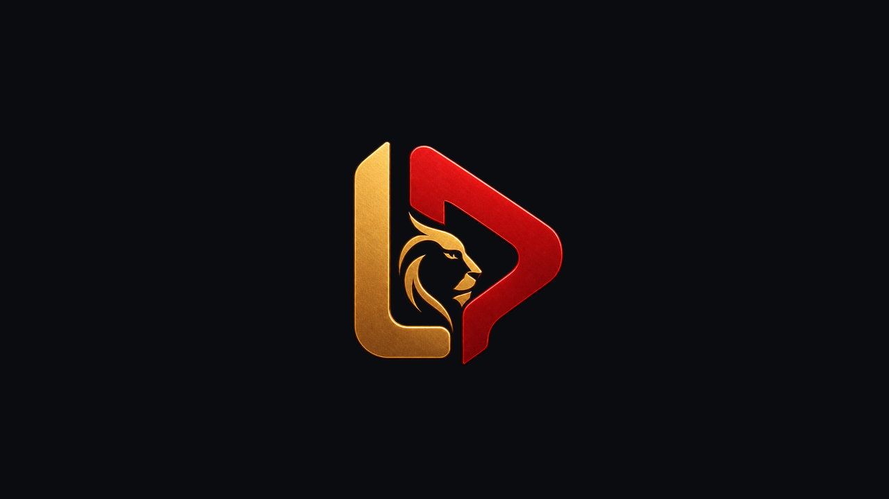
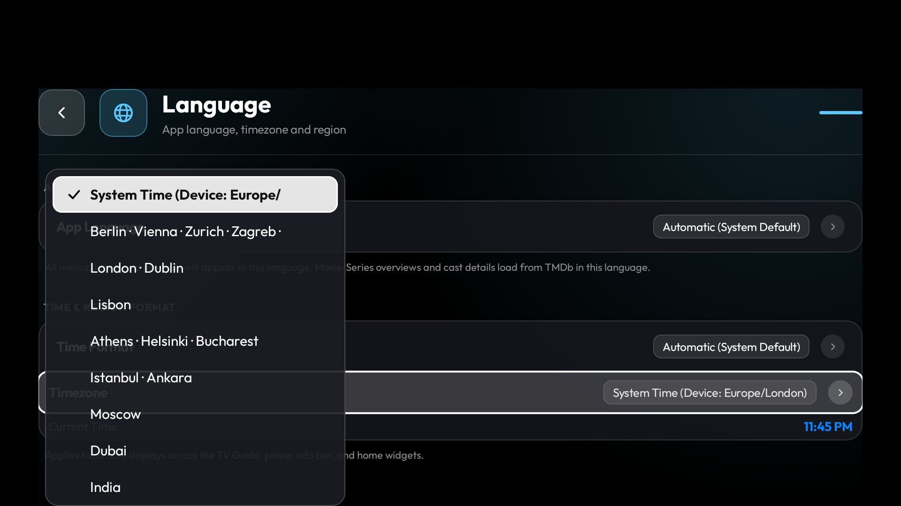
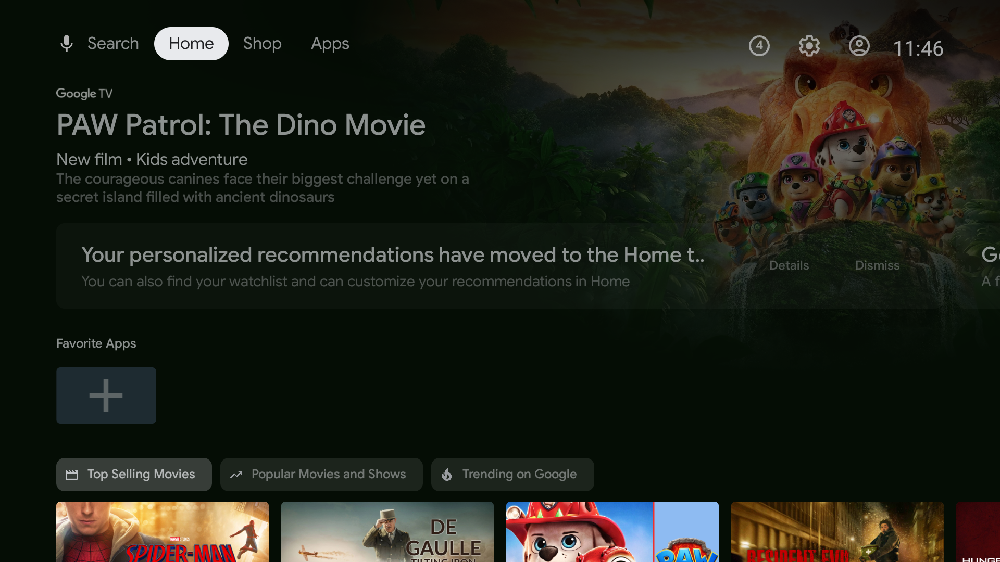
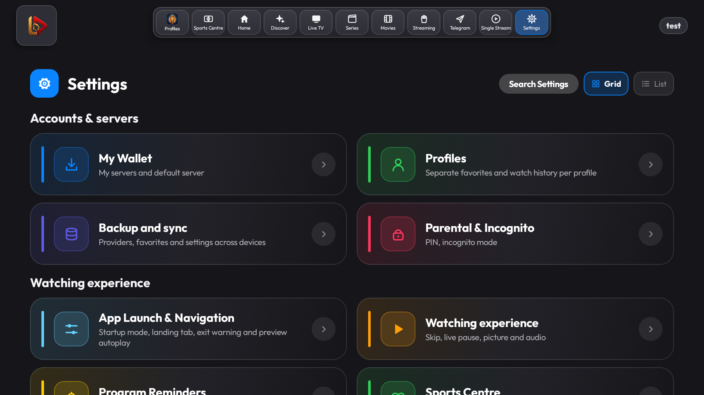

# 👑 LionPlay TV

<div align="center">



### Android TV ve Amazon Fire TV İçin Yeni Nesil Medya Oynatıcı

[-34C759?style=for-the-badge&logo=android)](https://github.com/lionplayiptvapp-bit/lionplay-tv/releases/download/v1.0.0/LionPlay-AndroidTV-FireTV.apk)
[](https://go.aftvnews.com/2007080)
[](LICENSE)

<br/>

[🇬🇧 Switch to English](README.md) &nbsp;•&nbsp; **🇹🇷 Türkçe Dokümantasyon**

</div>

---

**Amazon Fire TV, Google TV ve Android TV** cihazları için özel olarak tasarlanmış, Kotlin, Jetpack Compose ve donanım hızlandırmalı Media3 / FFmpeg mimarisiyle geliştirilmiş modern, koyu cam (dark glass) IPTV medya oynatıcısı. Televizyon kumandaları (D-Pad) ile %100 uyumlu ve akıcı gezinme deneyimi sunar.

<div align="center">
  
</div>

> **⚖️ Yasal Uyarı:** LionPlay herhangi bir medya içeriği, televizyon kanalı, yayın akışı veya oynatma listesi barındırmaz, satmaz ve dağıtmaz. Kullanıcıların yasal olarak erişim hakkına sahip olduğu kişisel IPTV kaynaklarını (Xtream Codes API, M3U / M3U8 çalma listeleri, Stalker portalları) televizyon ekranında oynatmak için geliştirilmiş bağımsız bir medya oynatıcı yazılımıdır.

---

## 📺 Platform ve Sürüm Uyumluluğu

> **💡 Tek Evrensel APK (Universal APK) Avantajı:**  
> Android TV ve Amazon Fire TV için uygulamayı iki ayrı kurulum paketine ayırmaya gerek yoktur. LionPlay, her iki ekosistemin sistem kütüphanelerini, televizyon kumandası (D-Pad) odak yönetimini ve mağaza servislerini tek bir evrensel APK dosyasında birleştirir. Aynı dosya tüm uyumlu televizyonlarda en yüksek performansla çalışır.

| Platform | Desteklenen Sürümler | Uyumlu Popüler Cihazlar | Durum |
| :--- | :--- | :--- | :--- |
| **Amazon Fire TV** | **Fire OS 6, 7, 8**<br>(Android 7.1 Nougat ila Android 11+) | Fire TV Stick (Lite, 4K, 4K Max), Fire TV Cube, Fire TV Edition Akıllı Televizyonlar | Tam Uyumlu (%100 Destek) |
| **Google TV** | **Android 10, 11, 12, 13, 14+** | Chromecast with Google TV (HD & 4K), Sony Bravia Google TV, TCL, Philips, Grundig | Tam Uyumlu (%100 Destek) |
| **Android TV** | **Android 6.0 Marshmallow (API 23) ila 14+** | Xiaomi Mi Box S, Mi TV Stick 4K, Nvidia Shield TV / Pro, Next, Nokia Streaming Box, Sunny | Tam Uyumlu (%100 Destek) |

---

## 🚀 Hızlı Kurulum Rehberi

### Yöntem 1: Downloader Uygulaması ile Kurulum (En Kolay ve Hızlı Yol)

Televizyonunuzun uygulama mağazasından (Amazon Appstore veya Google Play Store) ücretsiz **Downloader by AFTVnews** uygulamasını açın:

1. Downloader arama çubuğuna **`2007080`** kodunu girin ve **Go** butonuna basın.  
   *(Alternatif kısa bağlantı: `is.gd/lionplayapk`)*
2. İndirme işlemi doğrudan resmi GitHub sunucularından başlayacaktır.
3. İndirme tamamlandığında ekrana gelen **Yükle (Install)** butonuna basarak kurulumu bitirin.

### Yöntem 2: Doğrudan İndirme Bağlantıları

* **Doğrudan Evrensel APK (GitHub Releases):**  
  [https://github.com/lionplayiptvapp-bit/lionplay-tv/releases/download/v1.0.0/LionPlay-AndroidTV-FireTV.apk](https://github.com/lionplayiptvapp-bit/lionplay-tv/releases/download/v1.0.0/LionPlay-AndroidTV-FireTV.apk)
* **Kısa İndirme Bağlantısı:** [https://is.gd/lionplayapk](https://is.gd/lionplayapk)
* **Web Dağıtım ve Yönetim Portalı:** [https://androidtvfireos.lionplay.workers.dev](https://androidtvfireos.lionplay.workers.dev)

### Yöntem 3: ADB veya USB Bellek ile Sideload

```bash
adb install -r LionPlay-AndroidTV-FireTV.apk
```

---

## ✨ Öne Çıkan Temel Özellikler

* **⚡ 4'lü Çoklu Ekran (Multi-View):** Aynı anda 4 farklı canlı spor veya haber yayınını tek ekranda donma veya ses çakışması olmadan eşzamanlı izleyin.
* **🤖 Gerçek Zamanlı AI Altyazı:** Yabancı canlı televizyon yayınlarında ve filmlerde anlık Türkçe altyazı ve ses çevirisi üretimi.
* **📺 Modern Oynatma Listesi Desteği:** Xtream Codes API, M3U / M3U8 bağlantıları veya dosyaları ile Stalker portal desteği. Birden fazla listeyi tek ekranda birleştirme imkanı.
* **🎬 Donanım Hızlandırmalı Oynatıcı:** Media3 (ExoPlayer) + FFmpeg tabanlı AC3, E-AC3 ve DTS ses çözücü, 4K HDR desteği ve otomatik kare hızı eşleme (AFR / Auto-FPS).
* **⏪ EPG ve Geriye Dönük Yayın (Catch-up):** Elektronik program rehberi (EPG), geriye dönük yayın arşivi ve program zamanlayıcıları.
* **🎨 Apple tvOS Koyu Cam Tasarım:** Akıcı animasyonlar, koyu cam (dark glass) estetiği ve televizyon kumandası ile sezgisel odak yönetimi.
* **🍿 Kişisel Medya Sunucuları:** Jellyfin, Plex, Emby ve yerel ağdaki SMB / NAS arşivlerinize doğrudan bağlantı.

---

## 📱 Çoklu Cihaz Yönetimi ve Dinamik QR Kod Portalı (1 Lisans = 5 Televizyon)

LionPlay tek bir lisans anahtarı ile **5 farklı televizyon cihazında** eşzamanlı kullanım imkanı sunar:

* **Kumandasız Hızlı Aktivasyon:** TV ekranında beliren dinamik QR kodu akıllı telefonunuzun kamerasıyla okutarak, televizyon kumandasıyla tek tek harf girmeden lisansınızı saniyeler içinde tanımlayabilirsiniz.
* **Cihazları Listeleme ve Çıkarma:** Telefondan açılan yönetim portalı üzerinden lisansınıza bağlı tüm televizyon modellerini görüntüleyebilir; eski veya kullanmadığınız cihazları tek dokunuşla silerek yeni televizyonlar için yer açabilirsiniz.
* **Güvenlik Güvencesi:** Cihaz yönetim bağlantısı cihazınıza özel kriptografik anahtarla oluşturulur. Yetkisiz cihaz silinmelerini önlemek adına bağlantı adresinizi üçüncü kişilerle paylaşmayınız.

---

## 🔄 Uygulama İçi Otomatik Güncelleme Sistemi (OTA)

Uygulamanızı güncellemek için yeniden kurulum yapmanıza, dosya indirmenize veya ayarlarınızı sıfırlamanıza gerek yoktur:

* **Otomatik Kontrol Seçeneği:** **Ayarlar ➔ Hakkında** menüsünden otomatik güncelleme denetimini açıp kapatabilirsiniz. Açık olduğunda uygulama her başlatıldığında yeni sürümleri arka planda sessizce kontrol eder.
* **Manuel Sürüm Sorgulama:** **Şimdi Güncelleme Ara** butonuna basarak yeni bir sürüm olup olmadığını hemen sorgulayabilir ve varsa tek tıkla doğrudan televizyon üzerinden indirip yükleyebilirsiniz.
* **Veri ve Liste Güvencesi:** Güncelleme işlemleri sırasında kayıtlı oynatma listeleriniz, favori kanallarınız, izleme geçmişiniz ve lisans bilgileriniz **eksiksiz olarak korunur**.

---

## 📸 Ekran Görüntüleri

| 🏠 Ana Sayfa Deneyimi | ⚡ Çoklu Ekran (Multi-View) ve EPG | ⚙️ Medya Merkezi ve Ayarlar |
| :---: | :---: | :---: |
| <br/><sub>Koyu cam gezinme ve içerik vitrini</sub> | <br/><sub>4 yayın eşzamanlı ve program rehberi</sub> | <br/><sub>Hesap yönetimi ve cihaz QR portalı</sub> |

---

## ❓ Sıkça Sorulan Sorular (SSS)

<details>
<summary><b>1. Fire TV için ayrı, Google TV için ayrı APK indirmem gerekir mi?</b></summary>
<br/>
Hayır. LionPlay evrensel (Universal) mimari ile derlenmiştir. Tek bir APK dosyası tüm Android TV, Google TV ve Amazon Fire TV modellerinde doğrudan ve sorunsuz çalışır.
</details>

<details>
<summary><b>2. Güncelleme yaptığımda kayıtlı kanallarım veya ayarlarım silinir mi?</b></summary>
<br/>
Kesinlikle hayır. LionPlay güncellemeleri mevcut veritabanını, lisansınızı ve kayıtlı oynatma listelerinizi koruyarak mevcut sistemin üzerine güvenle kurulur.
</details>

<details>
<summary><b>3. Bir lisans kodunu kaç farklı cihazda kullanabilirim?</b></summary>
<br/>
LionPlay lisansı ile 5 farklı televizyon cihazını eşzamanlı olarak aktif edebilirsiniz. Cihaz limitine ulaştığınızda televizyondaki QR kodu telefonunuzla okutarak eski cihazlarınızı tek tıkla silebilir ve yeni televizyonunuzu ekleyebilirsiniz.
</details>

<details>
<summary><b>4. Uygulama içi TMDB veya OMDb API anahtarları girmek zorunlu mudur?</b></summary>
<br/>
Zorunlu değildir. Sağlayıcınızın kendi afiş ve yayın bilgileri doğrudan kullanılır. Ancak isteğe bağlı olarak ücretsiz TMDB veya OMDb anahtarı eklerseniz film ve dizilerin Türkçe açıklamaları, IMDb puanları ve oyuncu kadrosu otomatik olarak zenginleştirilir.
</details>

<details>
<summary><b>5. Televizyonumda ses geliyor ancak siyah ekran varsa ne yapmalıyım?</b></summary>
<br/>
Ayarlar menüsünden donanım hızlandırma modunu kontrol edebilir veya oynatıcı motorunu Tunneled / Auto-FPS moduna alarak cihazınızın yonga setine en uygun görüntü çıkışını sağlayabilirsiniz.
</details>

---

## 📄 Lisans ve Telif Hakkı

Copyright (C) 2026 LionPlay TV Katkıda Bulunanları.  
LionPlay, **GNU General Public License v3.0 (GPL-3.0)** kapsamında yayınlanan özgür ve açık kaynak kodlu bir yazılımdır. FFmpeg yerel ses çözücü kütüphanelerini içerir. Ayrıntılı bilgi için [LICENSE](LICENSE) dosyasına başvurabilirsiniz.
